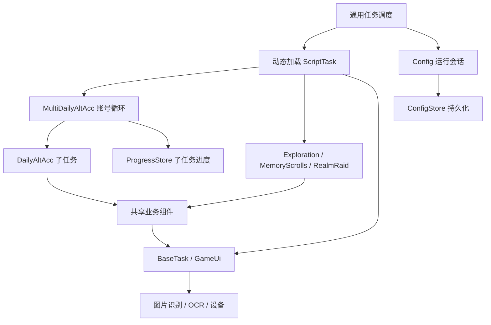

# OAS Personal：当前架构

更新日期：2026-10-02。本轮整理的代码基线：`be4160dffb2615e66f97d20163196a420dbdd68a`。来源：S1/S3与本轮只读核查；[证据说明](README.md#evidence)。

## 1. 目录职责

| 位置 | 当前职责 | 关键入口 |
|---|---|---|
| 根目录 | 服务和任务运行入口 | [script.py](../../script.py) |
| tasks | 业务任务、任务配置、页面、识别资源 | 通常为 script_task.py、config.py、assets.py |
| tasks/Component | 通用战斗、切号、进度、主题等复用能力 | GeneralBattle、MultiAccountRunner、SwitchAccount、Costume |
| module | 配置、设备、原子识别、OCR、服务与通知 | [BaseTask](../../tasks/base_task.py)调用这些基础能力 |
| config | 配置 JSON、模板、任务数据与配置身份信息 | [Config](../../module/config/config.py)、[ConfigStore](../../module/config/config_store.py) |
| assets | 顶层以国际化等资源为主 | 大量游戏识别图片实际在各任务目录 |
| dev_tools | 资源提取与开发辅助 | [assets_extract.py](../../dev_tools/assets_extract.py) |
| docs | 使用说明和本审计入口 | [README](README.md) |
| tests | 本地离线回归等验证资料 | 文件存在不代表与当前生产接口兼容或已通过 |

不可将顶层 assets 描述为所有游戏图片的统一中心，也不能直接覆盖生成的 assets.py 来完成资源迁移。

## 2. 核心关系

该图表示依赖关系，不表示所有任务都走 MultiDaily 或统一的状态机。MultiDaily 的账号主循环仍在自身脚本中，没有完整委托给 MultiAccountRunner.run。

## 3. 调度与 Task 生命周期

1. Config.update_scheduler 按 enable、next_run 等条件产生待执行和等待队列。
2. module/config/scheduler.py 提供 FILTER、FIFO、PRIORITY 等选择策略；Restart 只有已进入队列时才能获得对应优先处理。
3. script.py::_run_task 动态加载 tasks/<command>/script_task.py，构造 ScriptTask(config, device)，调用 run。
4. 任务使用 BaseTask 和共享组件执行页面与业务流程。
5. 任务通过 task_delay/task_call 等安排后续；TaskEnd 表示控制流正常结束，不自动证明奖励或业务目标完成。
6. 异常处理区分游戏未启动、设备卡死、未知页面、人工接管等；通用 Exception 可能退出实例，不能宣称全部错误自动恢复。

**FW-01：** task_call(force_call=True) 当前只更改 next_run。enable=False 的任务仍被队列过滤；“强制请求成功”不代表 Restart 或其他依赖任务会执行。

任务调度与多实例限流是不同问题。外部实例队列不能替代当前多账号日常。

## 4. 配置体系

| 层次 | 当前能力 | 维护边界 |
|---|---|---|
| ConfigModel | Pydantic 聚合任务模型与校验 | 新字段须兼容旧配置 |
| ConfigStore | canonical、generation、生命周期锁、字段操作、三方合并、冲突/blocked 状态 | 不用外部整模型保存覆盖 |
| Config 会话 | 保存运行模型、基线和配置变化状态 | 嵌套任务临时参数必须隔离 |
| ConfigWatcher | mtime_ns 与内容摘要发现变化 | 自身保存和外部编辑不能混淆 |
| 分级热更新 | HOT/WARM/COLD，安全检查点与任务边界更新 | 不等于所有字段立即生效 |
| 多账号业务配置 | 任务总开关、账号字段、阶段计划和进度 | 与通用配置身份不是同一套键 |

[config_reload.py](../../module/config/config_reload.py)按 schema 派生允许中途更新的标量路径；scheduler、设备和结构性字段受到排除或不同边界约束。Config 在安全检查点处理 HOT，任务边界处理 WARM，设备相关 COLD 需要进程级重启。

当前已经有配置热更新和安全保存，不能把它们写成未来首次从官方引入的能力。真正待完善的是业务任务对配置变化、派生缓存和进度身份的适配。

## 5. 图片识别与资源生成

- [RuleImage](../../module/atom/image.py)：ROI、模板、多尺度、多目标及特征匹配；模板按需加载并缓存。
- [RuleAnimate](../../module/atom/animate.py)：动画稳定判断；首帧 ROI 一致性存在待处理问题。
- BaseTask 提供 appear、click、等待和 RGB 辅助判断，按具体 Rule 类型分派。
- 任务内 JSON/PNG 等描述经资源提取器生成 assets.py。
- Costume 会替换局部资源，部分路径已有默认快照和缓存失效保护；不能假定所有主题均正确还原。
- 当前尚无已验证完整的活动/主题/账号分层资源 manifest 解析器。

IMG-01：当前多尺度匹配保存最佳位置，但点击框尺寸可能来自最后一档尺度。IMG-02：动画首帧使用整图，而后续帧裁 ROI。两者细节见 [第三方对比](05_ThirdParty_Comparison.md)。

外部 RuleImageGroup、新 path 参数或 mask 方法名不与当前构造和点击接口天然兼容。模板匹配成功也不能保证动作分派成功。

## 6. OCR 体系

[module/ocr/models.py](../../module/ocr/models.py)提供当前 RapidOCR/PP-OCRv6 的本地模型和 RPC 代理；[RuleOcr](../../module/atom/ocr.py)提供文本、数字、计数、时长、数量等业务接口。

当前已有延迟加载、共享缓存和非活跃释放。RPC 连接创建失败存在本地降级路径，但不能扩大成“任何 RPC 运行错误都会自动降级”。

OCR 输出仍需业务校验：页面正确、格式正确、范围合理、容量/前后变化一致。空输出在部分数字接口中成为 0，业务调用方不能将它无条件当真实 0% 或排名 0。

性能权衡：任务结束通知 OCR 非活跃后，最后活跃实例结束可释放模型。连续短任务可能反复冷加载；需要测量加载次数、冷热耗时、闲置内存和峰值，再考虑保温宽限期。

## 7. 页面与战斗状态

当前 GameUi 已有 PageRegistry、动态加载任务 page.py、页面图和覆盖页处理。它不是“完全没有注册或导航状态”。

业务任务仍使用局部 Scene、页面条件和分段循环。官方 dev 的差异主要是把 Registry、Matcher、Action、Navigator、Session 等职责分开，当前不宜整体替换。

共享战斗正确路径是 [tasks/Component/GeneralBattle/general_battle.py](../../tasks/Component/GeneralBattle/general_battle.py)，安全奖励判断是 [reward_frame.py](../../tasks/Component/GeneralBattle/reward_frame.py)。这些是 Exploration、RealmRaid 等任务的重要依赖。

未来只在现有安全边界外逐步明确“进入、战斗、奖励、返回”的结果，不先迁移整套外部 BattleWait。

## 8. 需要验证

- 具体任务是否正确响应 HOT 更新及清理派生缓存。
- 多账号临时配置中途保存是否污染独立任务配置。
- 无效 OCR、资源切换和跨账号缓存失效路径。
- 每阶段截图/OCR/模板匹配次数，以及 CPU、内存和耗时基线。
- Personal 与历史上游的精确基线映射。

本轮只做源码和文档静态核查，未运行应用、测试或游戏。
